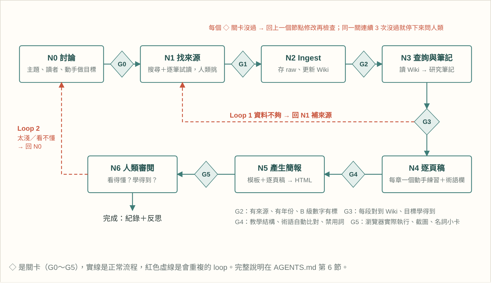

# 理財新手村：新手投資順序與看懂盤面

用 [Karpathy 的 LLM Wiki](https://gist.github.com/karpathy/442a6bf555914893e9891c11519de94f) 架構，整理台股新手該知道的投資順序與看盤基本功，再從 Wiki 產生一份可以動手練習的教學 HTML 簡報。

> 本專案僅供學習，不構成任何投資建議，也不推薦任何商品。

## 看哪裡

| 想看 | 位置 |
|---|---|
| 入口網頁（流程圖） | `index.html`（GitHub Pages 首頁） |
| 教學簡報（24 頁） | `decks/2026-11-22-invest-order-and-quotes/index.html` |
| Wiki 目錄 | [`wiki/index.md`](wiki/index.md) |
| 名詞小辭典 | [`wiki/glossary.md`](wiki/glossary.md) |
| 執行與檢查紀錄、反思 | [`runs/2026-11-22-invest-order-and-quotes.md`](runs/2026-11-22-invest-order-and-quotes.md) |
| 規則書（流程、關卡） | [`AGENTS.md`](AGENTS.md) |

## 三層架構

- `raw/`：原始來源的重點筆記（23 份，不改動）
- `wiki/`：AI 整理的概念頁、制度頁、來源摘要
- `AGENTS.md`：告訴 AI 怎麼整理、怎麼檢查的規則書

## 流程

N0 討論 → N1 找來源 → N2 Ingest → N3 筆記 → N4 逐頁稿 → N5 產生簡報 → N6 人類審閱，中間有 G0～G5 六個關卡；G3 資料不夠會回 N1（Loop 1），N6 覺得太淺或看不懂會回 N0（Loop 2）。



## 自動檢查

```bash
python3 scripts/check.py G2            # Wiki：來源、年份、B 級數字、孤兒頁
python3 scripts/check.py G3 <slug>     # 筆記每段都對到 Wiki
python3 scripts/check.py G4 <slug>     # 逐頁稿：教學結構、術語第一次出現有解釋
python3 scripts/check.py G5 <slug>     # 簡報：瀏覽器實際執行、名詞小卡、截圖（需要 playwright）
```
